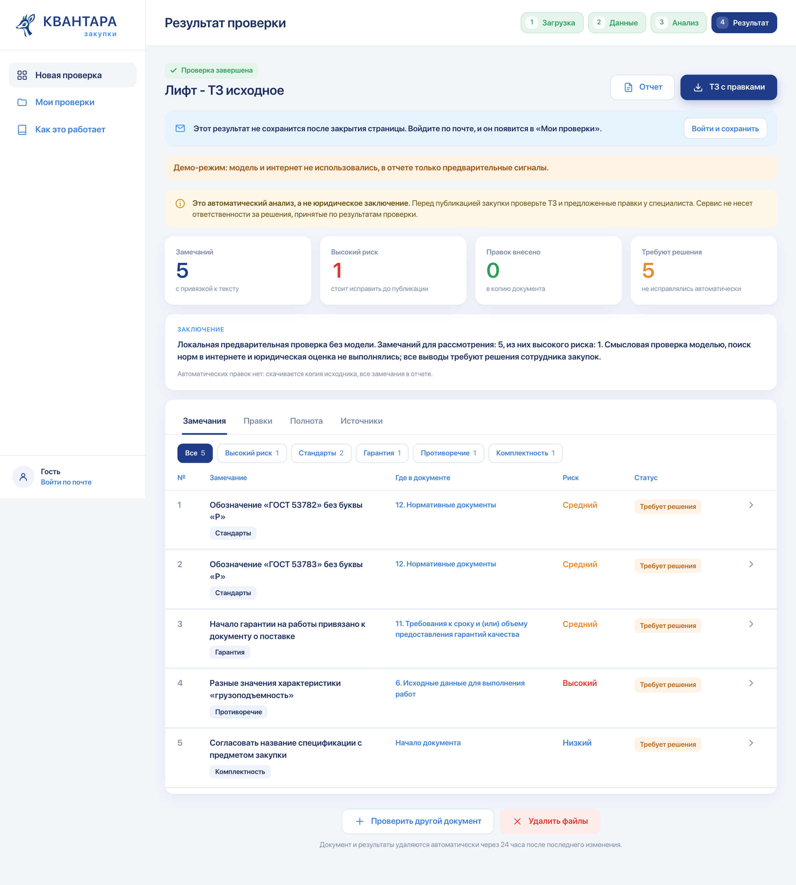
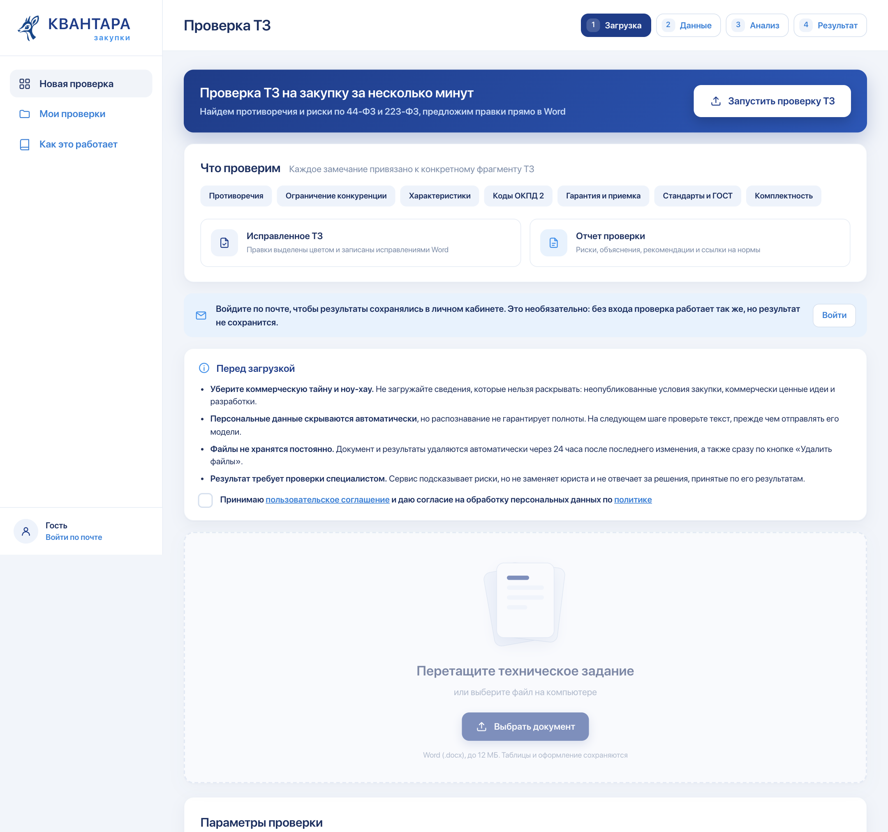
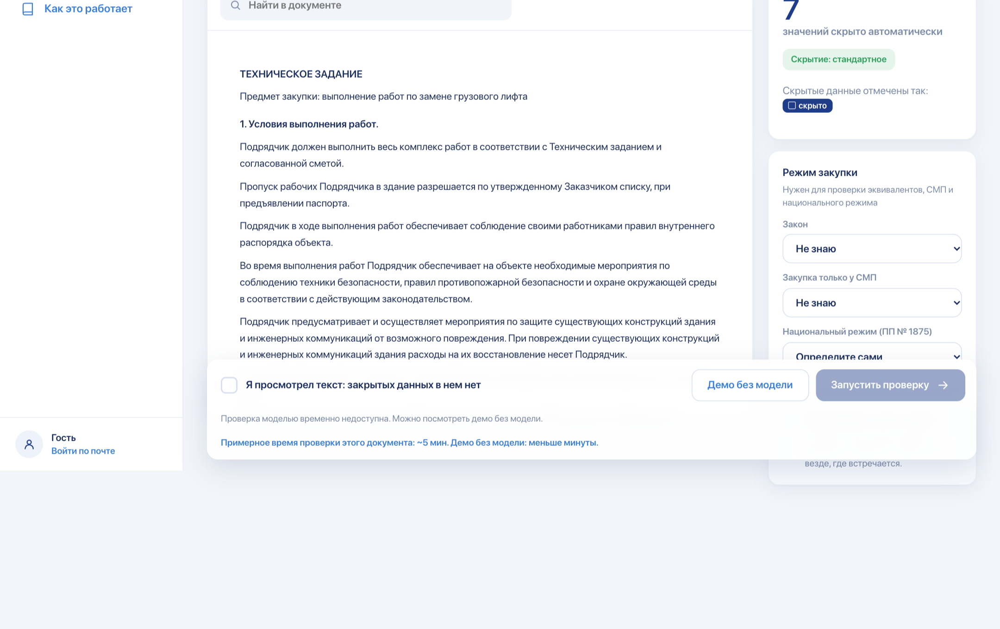
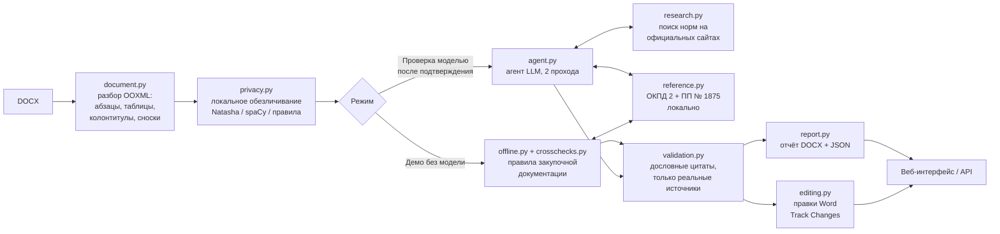

# Квантара.Закупки — проверка ТЗ на закупку

Сервис проверяет техническое задание на закупку (DOCX) и выдаёт структурированный отчёт для сотрудника закупок, а также копию ТЗ с правками в режиме исправлений Word.

Что находит сервис:

- **противоречия** между разделами и таблицами (разные значения одной характеристики, размеры, количества);
- **ограничение конкуренции**: товарные знаки, модели и артикулы без «или эквивалент», «или аналог», характеристики одной модели;
- **некорректные характеристики** и единицы измерения;
- **неверные коды ОКПД 2**: сверка с локальным классификатором Росстата и мерами национального режима (ПП РФ № 1875);
- **проблемы гарантии и приёмки**: отсутствие условий, начало гарантии на работы от документа о поставке;
- **проблемы со стандартами**: ГОСТ без «Р», неточные обозначения;
- **неполноту и комплектность**: незаполненные поля, работы, которых нет в спецификации, комплекты с единым кодом.

Каждое замечание привязано к дословной цитате и месту в документе (раздел, абзац, строка таблицы). Для замечания указаны категория, риск, объяснение, предлагаемая правка и ссылка на источник, если вывод опирается на внешнюю норму. Если основание не подтверждено, сервис прямо пишет «требует решения».



---

## Содержание

1. [Быстрый старт (Docker)](#быстрый-старт-docker)
2. [Как пользоваться](#как-пользоваться)
3. [Типовые сценарии](#типовые-сценарии)
4. [Архитектура и поток данных](#архитектура-и-поток-данных)
5. [Настройки и переменные окружения](#настройки-и-переменные-окружения)
6. [Внешние сервисы](#внешние-сервисы)
7. [Запуск без Docker и CLI](#запуск-без-docker-и-cli)
8. [API](#api)
9. [Тесты](#тесты)
10. [Ограничения](#ограничения)
11. [Структура репозитория](#структура-репозитория)

---

## Быстрый старт (Docker)

**Требования:** Docker Engine 24+ и Docker Compose v2.24+ (Linux, macOS или Windows с Docker Desktop), 2 ГБ свободной памяти, доступ в интернет на время сборки образа.

```bash
git clone https://github.com/ZlatikObr/hakaton.git
cd hakaton
docker compose up --build -d
```

Откройте **http://127.0.0.1:8000**. Состояние сервиса:

```bash
curl http://127.0.0.1:8000/health
```

Ответ `{"status":"ok"}` означает, что сервис готов. Healthcheck встроен в образ, поэтому `docker compose ps` показывает `healthy`.

Остановить (проверки сохраняются в томе `audit-data`):

```bash
docker compose down
```

Остановить и удалить все данные:

```bash
docker compose down -v
```

**Ключ модели необязателен.** Без него работает локальная проверка «Демо без модели»: правила плюс справочник ОКПД 2 и ПП № 1875, без внешних запросов. Чтобы включить проверку моделью, создайте `.env`:

```bash
cp .env.example .env
```

Впишите в `.env` строку `OPENROUTER_API_KEY=...` (для поиска норм в интернете — ещё `TZ_WEB_ENABLED=true`) и перезапустите сервис:

```bash
docker compose up -d
```

Исходный код менять не нужно: все настройки задаются переменными окружения.

---

## Как пользоваться

### 1. Загрузка

Отметьте согласие с условиями и перетащите `.docx` в область загрузки или нажмите «Запустить проверку ТЗ». Для пробы подойдут файлы из папки [`examples/`](examples).



### 2. Проверка данных перед отправкой

Сервис разбирает документ (абзацы, таблицы, колонтитулы, сноски) и **локально** скрывает персональные данные: ФИО, телефоны, e-mail, адреса, реквизиты. Скрытые значения подсвечены. Если что-то пропущено, выделите фрагмент мышью и скройте его вручную.

Справа задайте режим закупки: закон (44-ФЗ или 223-ФЗ), закупка у СМП, национальный режим. От режима зависит, какие требования проверяются.



Дальше два варианта:

- **«Демо без модели»** — локальные правила, результат за секунды, без внешних запросов;
- **«Запустить проверку»** — смысловой анализ моделью (нужен ключ). Сначала отметьте «Я просмотрел текст»: в модель уходит только обезличенный текст и только после этого подтверждения.

### 3. Анализ

На экране видны этапы, оставшееся время, найденные фрагменты и проверяемые темы. Проверку можно остановить. Проверка моделью занимает 2–6 минут в зависимости от объёма документа.

### 4. Результат

- **Заключение** — краткая сводка рисков по документу.
- **Замечания** — таблица с фильтрами по категориям и риску. Откройте строку, чтобы увидеть цитату, объяснение, рекомендацию и ссылку на источник.
- **Правки** — предложенные изменения. Можно выбрать нужные и собрать новую версию документа без повторного запуска модели.
- **Полнота** — какие темы проверены, какие не применимы, а какие не удалось подтвердить.
- **Источники** — нормативные документы, на которые ссылается отчёт, с датой получения.

Кнопки вверху скачивают **«Отчёт»** (DOCX для сотрудника закупок) и **«ТЗ с правками»**: копию исходного Word, где изменения записаны исправлениями Word и выделены цветом (Рецензирование → Все исправления). Исходный файл не изменяется.

Если войти по почте, проверка сохранится в разделе «Мои проверки».

---

## Типовые сценарии

### Сценарий 1. Работы по замене оборудования (ТЗ на замену лифта)

**Вход:** [`examples/Лифт - ТЗ исходное.docx`](examples): ТЗ на работы с поставкой оборудования, спецификацией и гарантийными условиями.

**Ожидаемый результат локальной проверки («Демо без модели»), 5 замечаний:**

| Категория | Замечание | Где в документе |
|---|---|---|
| Противоречие (высокий риск) | Грузоподъёмность 500 кг в описании и 300 кг в таблице исходных данных | Раздел 6 и таблица исходных данных |
| Стандарты (2 замечания) | «ГОСТ 53782» и «ГОСТ 53783» без буквы «Р», предложена правка «ГОСТ Р …» | Раздел 12 «Нормативные документы» |
| Гарантия | Гарантия на работы отсчитывается от товарной накладной | Раздел 11 |
| Комплектность | Предмет закупки — «работы по замене», а спецификация названа «ремонтные работы» | Предмет закупки и заголовок спецификации |

**С моделью** дополнительно находятся тип лифта (пассажирский или грузовой), разночтения в размерах проёма, неверный код ОКПД 2 работ, отсутствующая позиция оборудования в спецификации, опечатки. На эталоне организаторов модель нашла 7 из 7 правок, часть из них внесена в Word автоматически.

### Сценарий 2. Поставка оборудования (метрологическое оборудование)

**Вход:** [`examples/Метрология - ТЗ исходное.docx`](examples): спецификация из комплектов приборов с кодами ОКПД 2 и условиями ПНР.

**Ожидаемый результат локальной проверки:**

| Категория | Замечание |
|---|---|
| Коды ОКПД 2 (высокий риск) | Кода `26.51.43.190` нет в классификаторе ОКПД 2; в ссылке приведена выписка из локального справочника |
| Коды ОКПД 2 | Комплекты из разнородных приборов под единым кодом, рекомендована декомпозиция |
| Конкуренция | Формулировка о российском реестре и национальном режиме требует сверки с ПП № 1875 |

**С моделью** дополнительно проверяются ПНР и инструктаж, комплектность, требования к стране происхождения и характеристики приборов.

### Сценарий 3. ТЗ из другой предметной области

Правила не привязаны к выданным примерам. На реальных ТЗ на канцтовары, сувениры, электронику, реагенты и лабораторное оборудование локальная проверка находит:

- «или аналог» вместо «или эквивалент», с готовой правкой;
- артикулы и модели без эквивалента;
- коды ОКПД 2, для которых действуют меры национального режима;
- незаполненные поля вида «Производитель ____»;
- отсутствие гарантийных условий.

Проверка на публичных ТЗ НИУ МЭИ и ГлавУпДК описана в [docs/evaluation-public.md](docs/evaluation-public.md).

---

## Архитектура и поток данных



| Компонент | Назначение |
|---|---|
| `tz_audit/document.py` | Безопасное чтение DOCX: без макросов, внешних ссылок и распаковки на диск. Каждый блок получает ID и адрес («таблица 2, строка 5; раздел 6»). Повреждённые и неподдерживаемые файлы отклоняются с понятной ошибкой. |
| `tz_audit/privacy.py` | Локальное скрытие ПД. Наружу передаётся только обезличенный пакет; отправка подтверждается digest его содержимого. |
| `tz_audit/offline.py`, `crosschecks.py` | Проверка без LLM: коды ОКПД 2, ГОСТ, эквиваленты, гарантия, незаполненные поля, работы вне спецификации, противоречивые значения и размеры. |
| `tz_audit/agent.py` | Агент с инструментами `search_norms`, `fetch_source`, `lookup_okpd2` и `submit_review`. Обязательный второй проход закрывает 9 тем (предмет, числа, комплектность, гарантия и приёмка, коды, стандарты, язык, конкуренция, режим закупки). |
| `tz_audit/reference.py`, `data/` | Классификатор ОКПД 2 (21 081 код) и меры ПП РФ № 1875 с контрольной суммой; работает без сети. |
| `tz_audit/research.py`, `network.py` | Поиск норм только по официальным доменам (pravo.gov.ru, consultant.ru, zakupki.gov.ru и др.); только HTTPS и публичные IP. |
| `tz_audit/validation.py` | Каждая цитата из ТЗ и из источника проверяется дословно. Ссылаться можно только на реально полученный источник, иначе замечание переводится в «требует решения». |
| `tz_audit/editing.py`, `report.py` | Копия DOCX с исправлениями Word и отдельный DOCX-отчёт. Спорные правки остаются предложениями. |
| `tz_audit/api.py`, `static/` | FastAPI и веб-интерфейс: фоновая очередь, прогресс, отмена, личный кабинет. |

**Как сервис избегает выдуманных оснований.** Модель не может сослаться на источник, который не был получен в текущей проверке, а цитата должна дословно совпадать с текстом источника. Если подтверждения нет, замечание получает статус «требует решения» с пометкой «внешнее основание не подтверждено». Правки по внешним нормам, кодам и стандартам никогда не вносятся автоматически: решение принимает сотрудник.

---

## Настройки и переменные окружения

Все переменные необязательны. Шаблон с комментариями — [`.env.example`](.env.example).

| Переменная | По умолчанию | Назначение |
|---|---|---|
| `OPENROUTER_API_KEY` | — | Ключ OpenRouter. Без него доступна только локальная проверка |
| `OPENROUTER_MODEL` | `moonshotai/kimi-k3.1-pro` | Модель анализа (нужна поддержка tools) |
| `LLM_API_URL`, `LLM_API_KEY`, `LLM_MODEL_NAME` | — | Любой OpenAI-совместимый API вместо OpenRouter |
| `TZ_WEB_ENABLED` | `false` | Поиск и чтение открытых нормативных источников |
| `TZ_SEARCH_BACKEND` | `openrouter` | `openrouter`, `brave` или `duckduckgo` |
| `TZ_SEARCH_MODEL` | `deepseek/deepseek-v4.1-flash-1017` | Модель изолированного поиска |
| `BRAVE_API_KEY` | — | Только для `TZ_SEARCH_BACKEND=brave` |
| `TZ_MAX_STEPS` | `12` | Максимум шагов агента (1–12) |
| `TZ_MAX_OUTPUT_TOKENS` | `12000` | Лимит токенов ответа модели |
| `TZ_API_TOKEN` | случайный | Bearer-токен для API-скриптов (не короче 24 символов) |
| `TZ_DATA_DIR` | `runs` (`/data` в Docker) | Каталог заданий |
| `TZ_RETENTION_HOURS` | `24` | Срок хранения документов, `0` — не удалять |
| `TZ_PORT` | `8000` | Порт на хосте |
| `SMTP_HOST`, `SMTP_PORT`, `SMTP_USER`, `SMTP_PASSWORD`, `SMTP_FROM` | — | Отправка кодов входа в личный кабинет |
| `TZ_AUTH_DEMO` | `false` | Показывать код входа на экране вместо письма (только для демо) |
| `TZ_COOKIE_SECURE` | `false` | `true`, если сайт открыт по HTTPS |

Встроенные лимиты: DOCX до 12 МБ и 220 000 символов, до 80 замечаний, до 6 поисков и 6 прочитанных источников на одну проверку.

---

## Внешние сервисы

| Сервис | Когда используется | Что передаётся |
|---|---|---|
| `openrouter.ai` (или ваш `LLM_API_URL`) | Проверка моделью | Только обезличенный текст и только после явного подтверждения пользователя. Маршрут ограничен провайдерами без хранения данных (`zdr=true`, `data_collection=deny`) |
| Поиск Exa через OpenRouter, Brave или DuckDuckGo | `TZ_WEB_ENABLED=true` | Только публичные темы поиска (номер ГОСТ, код ОКПД 2, название закона); текст ТЗ не передаётся |
| Официальные сайты норм (pravo.gov.ru, consultant.ru, gost.ru, zakupki.gov.ru и др.) | `TZ_WEB_ENABLED=true` | HTTPS-запрос найденной страницы |
| SMTP-сервер | Если настроен вход по почте | Адрес пользователя и код входа |

Локальная проверка, справочник ОКПД 2, обезличивание и формирование отчётов внешних сервисов не используют. Во внешние API уходят только открытые данные, как требуют условия кейса.

---

## Запуск без Docker и CLI

Нужен Python 3.11–3.13.

```bash
python3 -m venv .venv
.venv/bin/pip install -r requirements.lock
.venv/bin/pip install --no-deps -e .
```

Веб-интерфейс на http://127.0.0.1:8000 (читает `.env`, остановка — Ctrl+C):

```bash
.venv/bin/python scripts/serve.py
```

Проверка из командной строки без модели:

```bash
.venv/bin/tz-audit demo "examples/Лифт - ТЗ исходное.docx"
```

Результат сохраняется в `runs/<job_id>/`: `report.json`, `report.docx` и `corrected.docx`.

Проверка моделью из CLI идёт в три шага: подготовить обезличенный пакет, просмотреть его, запустить анализ с подтверждённым digest.

```bash
.venv/bin/tz-audit prepare "examples/Лифт - ТЗ исходное.docx"
```

```bash
.venv/bin/tz-audit preview JOB_ID
```

```bash
OPENROUTER_API_KEY=... .venv/bin/tz-audit analyze JOB_ID --mode openrouter --approve-digest DIGEST
```

---

## API

Схема доступна по адресу `/openapi.json`. Для запросов из скриптов нужен заголовок `Authorization: Bearer $TZ_API_TOKEN`; сервис должен быть запущен с тем же `TZ_API_TOKEN`.

| Метод | Путь | Назначение |
|---|---|---|
| GET | `/health` | Проверка готовности |
| POST | `/jobs` | Загрузка DOCX (`file`, необязательно `privacy_backend`) |
| GET | `/jobs/{id}` | Обезличенный предпросмотр и digest |
| POST | `/jobs/{id}/redactions` | Скрыть дополнительный фрагмент |
| POST | `/jobs/{id}/analyze` | Синхронный анализ: `{"mode":"offline"}` или `{"mode":"openrouter","approved_digest":"…"}` |
| POST | `/jobs/{id}/run` | То же в фоне, с параметром `procurement` (закон, СМП, нацрежим) |
| GET | `/jobs/{id}/status` | Этап, прогресс, журнал событий |
| POST | `/jobs/{id}/cancel` | Остановить проверку |
| GET | `/jobs/{id}/report.json`, `/jobs/{id}/report.docx` | Отчёт |
| GET | `/jobs/{id}/corrected.docx` | ТЗ с правками |
| GET, POST | `/jobs/{id}/proposals`, `/jobs/{id}/apply-selected` | Выбор отдельных правок без повторного анализа |

Пример:

```bash
curl -H "Authorization: Bearer $TZ_API_TOKEN" -F "file=@examples/Лифт - ТЗ исходное.docx" http://127.0.0.1:8000/jobs
```

```bash
curl -H "Authorization: Bearer $TZ_API_TOKEN" -H "Content-Type: application/json" -d '{"mode":"offline"}' http://127.0.0.1:8000/jobs/JOB_ID/analyze
```

Формат `report.json`:

- `review.summary` — итоговое заключение;
- `review.findings[]` — замечания с полями `category`, `severity`, `status`, `title`, `anchors[]` (`block_id`, `quote`), `explanation`, `recommendation`, `basis`, `citations[]`, `edits[]`;
- `review.coverage[]` — полнота проверки по темам;
- `sources[]` — полученные источники;
- `changes[]` — что внесено в Word, а что оставлено предложением.

---

## Тесты

```bash
.venv/bin/pip install pytest httpx
.venv/bin/python -m pytest -q
```

```bash
npm ci --ignore-scripts && npm test
```

Python-тесты (238) покрывают: разбор DOCX и таблиц; повреждённые архивы, XML-бомбы и макросы; обезличивание; локальные правила, включая отсутствие ложных срабатываний на корректных фрагментах; проверку цитат и источников; запрет произвольных URL и SSRF; правки Word; API, личный кабинет и сквозной сценарий. UI-тесты (`tests/ui.test.mjs`) проверяют интерфейс в jsdom.

Сравнение отчёта с эталонами организаторов:

```bash
.venv/bin/python -m scripts.evaluate runs/JOB_ID/report.json --case lift
```

---

## Ограничения

- На вход принимается только DOCX. Старый `.doc`, сканы и PDF без текстового слоя нужно сначала пересохранить или распознать. Изображения внутри документа не анализируются, об этом выводится предупреждение.
- Номера страниц в DOCX не вычисляются: привязка выполняется к разделу, абзацу и строке таблицы.
- Локальный режим — предварительный скрининг по правилам. Смысловые противоречия (например, тип изделия) находит только модель.
- Юридическая применимость норм и актуальность редакций автоматически не удостоверяются: такие выводы всегда помечены «требует решения».
- Обезличивание на основе NER не гарантирует полноты, поэтому перед отправкой в модель текст нужно просмотреть.

---

## Структура репозитория

```
├── tz_audit/                 # сервис
│   ├── api.py                # FastAPI: веб-интерфейс и REST API
│   ├── service.py            # жизненный цикл задания
│   ├── document.py           # разбор DOCX
│   ├── privacy.py            # обезличивание
│   ├── offline.py            # проверка без модели
│   ├── crosschecks.py        # сверка размеров и заголовков
│   ├── agent.py              # агент LLM
│   ├── research.py           # поиск норм
│   ├── reference.py          # ОКПД 2 и ПП № 1875
│   ├── validation.py         # проверка цитат и источников
│   ├── editing.py, report.py # Word с правками и отчёт
│   ├── data/                 # справочники (происхождение — data/SOURCE.md)
│   └── static/               # интерфейс
├── tests/                    # pytest и UI-тесты
├── examples/                 # ТЗ организаторов: исходные и эталонные версии
├── scripts/                  # запуск, оценка качества, служебные проверки
├── docs/                     # оценка на публичных ТЗ, скриншоты
├── deploy/                   # скрипты обслуживания сервера (SMTP, смена модели)
├── integrations/             # необязательный адаптер DeepSeek Harness
├── Dockerfile
├── compose.yaml
└── .env.example
```
